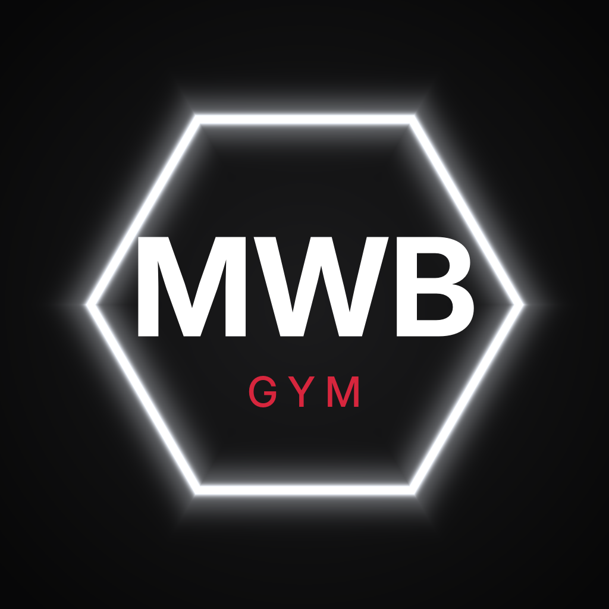

# Natural Bodybuilding.  
Discipline > Motivation.

MarcelWB Gym ist der Fitness-Kanal von [@marcelwb_gym](https://www.tiktok.com/@marcelwb_gym) auf TikTok: Natural Bodybuilding, Training, Transformation und Gym-Lifestyle.

## MarcelWB Gym Studio

Ein privates Werkzeug, mit dem der Kanalinhaber die Statistiken des eigenen TikTok-Kontos auswertet, um bessere Inhalte zu planen. Die Anmeldung erfolgt ausschließlich über den offiziellen TikTok-Login (OAuth). Es werden nur Leserechte verwendet: Profilstatistiken und die Liste der öffentlichen Videos mit ihren Kennzahlen. Es werden keine Inhalte veröffentlicht, bearbeitet oder gelöscht.

*MarcelWB Gym Studio is a private tool the channel owner uses to analyse the statistics of their own TikTok account via the official TikTok Login Kit and Display API (read-only).*

### Nach dem TikTok-Login hier gelandet?
Die Verbindung war erfolgreich, wenn die Adresse oben im Browser `?code=` enthält. Halte die Adresszeile gedrückt, tippe auf **Kopieren** und füge die komplette Adresse im GitHub-Workflow **„TikTok verbinden“** ein. Der Code ist nur wenige Minuten gültig.

---
[Datenschutzerklärung / Privacy Policy](PRIVACY.md) · [Nutzungsbedingungen / Terms of Service](TERMS.md)
